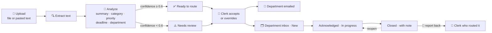

# 📥 AI Smart Inbox

**Turning hours of manual mail sorting into seconds, with a human always in the loop.**

AI Smart Inbox is an inbox for official correspondence. Upload a letter, PDF, scan, Word file or email. The system reads it, summarizes it in **Arabic and English**, classifies it, pulls out the key data (sender, reference number, dates, deadlines, action items) and **suggests which department should handle it**, with a confidence score and the reason for its choice. A clerk confirms or corrects the suggestion. The department is notified by email, works the item in its own inbox, and closes it with a note. Every step is recorded on the document's timeline.

It runs **free by default**: a built-in rule engine and an optional local LLM (Ollama). Claude can be switched on for the best quality.

    

<!-- Hero GIF: docs/demo.gif (upload → AI analysis → route → department closes) -->

## Contents

- [How it works](#how-it-works)
- [Features](#features)
- [Quick start](#quick-start)
- [Architecture](#architecture)
- [Analysis engines](#analysis-engines-free-by-default)
- [Sign-in and roles](#sign-in-and-roles)
- [Email notifications](#email-notifications)
- [Configuration](#configuration)
- [AI evals](#ai-evals)
- [API](#api)
- [Roadmap](#roadmap)

## How it works

### The life of a letter



1. **A clerk uploads correspondence:** a PDF, Word file, image, `.eml` email, or pasted text. The file is stored, and the document appears in the inbox as *Analyzing*.
2. **A background worker extracts the text.** Digital PDFs use PdfPig, Word files are read directly, and emails use MimeKit. Scans and photos have no text layer, so they are kept for a vision-capable model.
3. **The analysis engine reads it.** It produces bilingual summaries, the category (request, complaint, invitation, circular, invoice, legal, other), priority, sender and recipient, reference number, document date, deadline, action items, and **one suggested department with a confidence score and reasoning**.
4. **Uncertain documents are flagged, not guessed.** Below 0.6 confidence a document goes to *Needs review*, so a person decides. Above it, it's *Ready to route*. Browsers update live over SignalR.
5. **The clerk decides.** One click accepts the suggestion; otherwise the clerk picks another department and adds a note. Each decision is stored as feedback, and the dashboard turns it into a real **AI routing accuracy** figure.
6. **The department is notified.** An email (outbox with retries) goes to the department's address, and the document lands in its inbox as **New**.
7. **The department works it.** The item is **assigned to a staff member**, who is emailed and finds it under *Assigned to me*. Colleagues coordinate in **internal comments**. Then **Acknowledge** (in progress) → **Close** with a note on what was done. Closing **emails the clerk who routed it**, including the note, which closes the loop. It can be reopened, or re-routed to another department, where it starts again as *New*.
8. **Deadlines are watched.** Each morning a department gets a **digest** of its open items that are overdue or due within 3 days. When an item passes its deadline unclosed, it is **escalated** to the department head.
9. **Everything is on the record.** The document's **activity timeline** shows who did what and when: received, analyzed, routed, emailed, acknowledged, closed, reopened.

### Who does what

| Role | Works in | Can |
|---|---|---|
| **Clerk** (correspondence desk) | Main inbox, dashboard | Upload, review AI results, route / re-route, re-analyze, see every department |
| **Department staff** | Their department's inbox, "Assigned to me" | View, assign within the department, comment, acknowledge, close and reopen their own department's documents |
| **Admin** | Everything + `/admin` | Manage users, roles and department email addresses |

### Document states

| Stage | States |
|---|---|
| Correspondence desk | `Analyzing` → `Ready to route` or `Needs review` (or `Failed`, which can be retried) → `Routed` |
| Department (after routing) | `New` → `In progress` → `Closed` (reopen → `In progress`) |

## Features

| | |
|---|---|
| **Upload anything** | PDF, DOCX, JPG/PNG, `.eml`, or pasted text, up to 20 MB. The file type is checked on the server. |
| **Bilingual analysis** | Arabic and English summaries, plus category, priority, parties, reference, dates, deadline and action items |
| **Routing with honest confidence** | One department plus a confidence score and reasoning; anything below 0.6 goes to human review |
| **Free AI by default** | Offline rule engine, local LLM via Ollama, or Claude, with a **hybrid cost gate** that only sends uncertain documents to an LLM |
| **Department inboxes** | New / In progress / Closed / Assigned to me, with closing notes and overdue indicators |
| **Assignment and comments** | Assign an item to a staff member of the department (they get an email); internal comment thread on every document, kept as part of the record |
| **Email notifications** | Routing, "closed" report-back, daily deadline digest, and escalation of overdue items to the department head; transactional outbox with retries; local test mail server |
| **Activity timeline** | Append-only history of every step, with who did it and when |
| **Sign-in** | Local accounts (ASP.NET Core Identity) and Microsoft Entra ID; three roles enforced by the API |
| **Arabic / English UI** | Full right-to-left layout, light and dark mode, works on mobile |
| **Live updates** | SignalR pushes status changes to every open browser |
| **Dashboard** | AI routing accuracy, volume by priority, category, status and department, token usage |
| **AI evals** | 20 labeled synthetic letters measure accuracy per field for each engine ([results](docs/EVALS.md)) |

## Quick start

### Docker (everything in one command)

```bash
docker compose up --build
```

| | |
|---|---|
| App | http://localhost:8080 |
| Test mail inbox (smtp4dev) | http://localhost:5100 |

Sign in with a demo account (password **`Demo#2026`**):

| Email | Role |
|---|---|
| `clerk@mds.demo` | Correspondence desk: start here, upload a file from [`samples/`](samples/) |
| `legal.user@mds.demo` · `legal.user2@mds.demo` | Legal Affairs department (Omar, Huda) |
| `hr.user@mds.demo` | Human Resources department |
| `admin@mds.demo` | Administrator |

**A 2-minute tour:**
1. As the clerk, upload [`samples/en-04-court-notice.txt`](samples/en-04-court-notice.txt).
2. Accept the suggestion (Legal Affairs).
3. Check the email at http://localhost:5100.
4. Sign in as `legal.user`, assign the document to Huda, and leave a comment. Sign in as `legal.user2` (Huda): it's under *Assigned to me*. Close it with a note.
5. As the clerk, open the document again and look at its timeline.

### Local development

Requirements: .NET 8 SDK, Node 22, SQL Server (local, or `docker compose up -d sqlserver`), and Docker for the test mail server.

```bash
# Your SQL Server connection (keep machine-specific values in user-secrets, not appsettings.json)
dotnet user-secrets set "ConnectionStrings:SmartInbox" "Server=.;Database=SmartInbox;Trusted_Connection=True;TrustServerCertificate=True" --project src/SmartInbox.Api

# Test mail server
docker run -d --name smart-inbox-smtp4dev -p 5100:80 -p 2525:25 rnwood/smtp4dev:v3

# API: http://localhost:5080 (Swagger at /swagger). Applies migrations and seeds demo users on start.
dotnet run --project src/SmartInbox.Api

# Web: http://localhost:5173 (proxies /api and /hubs to :5080)
cd src/smart-inbox-web && npm install && npm run dev
```

Optional local LLM: install [Ollama](https://ollama.com), then `ollama pull qwen2.5:3b`.

Tests:

```bash
dotnet test tests/SmartInbox.UnitTests
dotnet run --project tests/SmartInbox.AiEvals -- --provider Rules    # free; also Ollama, Hybrid, Claude
```

## Architecture

```
┌──────────────┐  REST + SignalR   ┌──────────────────────────────────────────┐      ┌──────────────┐
│  Vue 3 SPA   │◀─────(cookie)────▶│          ASP.NET Core 8 Web API          │─────▶│  SQL Server  │
│ Vite · TS ·  │                   │  Identity / Entra ID · role policies     │      └──────────────┘
│ PrimeVue ·   │                   │                                          │      ┌──────────────┐
│ i18n (AR/EN) │                   │  DocumentProcessingWorker ◀─ Channel     │─────▶│ File storage │
└──────────────┘                   │   ├ ITextExtractor (PDF, DOCX, EML, TXT) │      └──────────────┘
                                   │   └ IAiProvider                          │      ┌──────────────┐
                                   │       ├ Rules (offline)                  │─────▶│ Ollama/Claude│
                                   │       ├ Ollama · Claude                  │      └──────────────┘
                                   │       └ Hybrid gate                      │      ┌──────────────┐
                                   │  NotificationWorker ◀─ outbox table      │─────▶│ SMTP server  │
                                   └──────────────────────────────────────────┘      └──────────────┘
```

Clean Architecture, one project per layer:

| Project | Purpose |
|---|---|
| `SmartInbox.Domain` | Entities and enums: documents, analyses, routing decisions, departments, notifications, timeline events |
| `SmartInbox.Application` | Use cases (`DocumentService`, `DocumentProcessor`, `NotificationDispatcher`), DTOs, validation, access rules, interfaces (`IAiProvider`, `ITextExtractor`, `IEmailSender`, `ICurrentUser`, …) |
| `SmartInbox.Infrastructure` | EF Core + Identity store, AI providers (rules, Ollama, Claude, gate), text extractors, SMTP (MailKit), file storage, background workers |
| `SmartInbox.Api` | Controllers, auth (cookie, Entra OIDC, policies), SignalR hub; also serves the built SPA |
| `smart-inbox-web` | Vue 3 + TypeScript + Pinia + PrimeVue + vue-i18n |
| `tests/SmartInbox.UnitTests` | Extractors, rule engine, pipeline, routing, department handling, access control, notifications, timeline |
| `tests/SmartInbox.AiEvals` | Runs the labeled samples through any engine and reports accuracy |

Design choices worth noting:
- **Pluggable AI.** Every engine implements `IAiProvider`, so adding Azure OpenAI or another model doesn't touch the pipeline.
- **Transactional outbox.** The routing decision and its email are saved together, so a mail outage can't lose a notification.
- **Access rules live in the application layer.** The API returns `404` to a department user asking for another department's document; the UI only hides what the role can't use.
- **Append-only timeline.** State fields show *now*; the event log shows *how it got there*.

## Analysis engines (free by default)

Set with `Ai:Provider`. **No API key or paid service is required.**

| `Ai:Provider` | Cost | What it does |
|---|---|---|
| `Rules` | Free, offline, instant | Bilingual keyword scoring for department and category; regex extraction for references, dates (English, Arabic, Arabic-Indic digits), deadlines and parties; rules for priority. Explainable: the reasoning lists the matched words. |
| `Ollama` | Free, on your machine | A local LLM through [Ollama](https://ollama.com) using the same JSON schema as Claude (default `qwen2.5:3b`) |
| `Claude` | Paid API | `claude-sonnet-5-5` with structured outputs, prompt caching, and vision for scanned documents |
| **`Hybrid`** (default) | Free unless `Ai:Llm=Claude` | **The cost gate.** Rules run first; only documents with confidence < `Ai:GateConfidence` (0.75) go to the LLM. When rules and LLM **disagree**, confidence is capped below 0.6 so a human decides. If the LLM is down, the rule result is kept. |

Each analysis records which engine produced it, and the review screen shows it.

With Claude or Ollama:
- The response is constrained to a strict JSON schema, so nothing is parsed out of free text.
- The instructions and department list form a stable, cacheable system prompt.
- The prompt asks for honest, low confidence when a document is ambiguous.
- Claude refusals use server-side fallbacks.
- Scans are read with vision, and the transcription is stored.

## Sign-in and roles

- **Local accounts** (ASP.NET Core Identity):
  - Hashed passwords, and lockout after 5 failed attempts.
  - An HttpOnly, `SameSite=Lax` cookie that SignalR also uses.
  - A role or department change takes effect within a minute.
- **Microsoft Entra ID** ("Sign in with Microsoft") appears when `Auth:Entra:TenantId`, `ClientId` and `ClientSecret` are set.
  - Add the redirect URI `https://<host>/signin-oidc` to the app registration.
  - A first-time Microsoft user is linked to an existing account by email, or created with **no role**. They see a "waiting for access" page until an admin assigns one.
- **Demo users** are seeded in Development and in the Docker demo. In production, set `Auth:SeedDemoUsers=false` and `Auth:AdminEmail` / `Auth:AdminPassword` to create the first admin.

## Email notifications

- **Four kinds of email:**
  - **Routed:** to the department's address.
  - **Closed:** to the person who routed it, with who closed it and the closing note. It is skipped if you close something you routed yourself. Documents with no recorded router fall back to `Notifications:DeskEmail`.
  - **Daily digest:** to each department, after `Reminders:DigestHour` local time. It lists open items that are overdue or due within `Reminders:DueSoonDays`, and is sent only when there is something to list.
  - **Escalation:** to the department head (`HeadEmail`, or the desk mailbox if none is set) once an item is past its deadline and still open. It is sent once per deadline, again if the item is re-routed, and recorded on the timeline.
- Scheduled reminders carry a **dedup key** (unique index), so the 15-minute scheduler, restarts or multiple instances never send the same reminder twice.
- Each email is added to the `Notifications` outbox in the same transaction as the action that caused it.
- A background worker sends it via SMTP (MailKit) and retries after 1, 5, 15 and 60 minutes before marking it failed.
- The document page shows *sent*, *queued* or *failed*; the timeline records delivery.
- The email is bilingual HTML, and all document text in it is escaped.
- For development, [smtp4dev](https://github.com/rnwood/smtp4dev) catches every email.
- Going live is configuration only: `Email:Host`, `Port`, `Security` (`StartTls` for Office 365 / Gmail), `Username`, `Password`, `FromAddress`.

## Configuration

`appsettings.json`, user-secrets, or environment variables (`Section__Key`). Docker variables are listed in [`.env.example`](.env.example).

| Key | Default | |
|---|---|---|
| `ConnectionStrings:SmartInbox` | local Docker SQL | SQL Server connection |
| `Ai:Provider` / `Ai:Llm` / `Ai:GateConfidence` | `Hybrid` / `Ollama` / `0.75` | Analysis engine |
| `Ollama:BaseUrl` / `Ollama:Model` | `http://localhost:11434` / `qwen2.5:3b` | Local LLM |
| `Claude:ApiKey` / `Claude:Model` | – / `claude-sonnet-5-5` | Only if Claude is used |
| `Email:Enabled` / `Host` / `Port` / `Security` | `true` / `localhost` / `2525` / `None` | SMTP |
| `Notifications:AppBaseUrl` | `http://localhost:5173` | Link in emails |
| `Notifications:DeskEmail` | – | Fallback recipient for "closed" emails and escalations |
| `Reminders:Enabled` / `DigestHour` / `DueSoonDays` / `TimeZone` | `true` / `8` / `3` / `Asia/Dubai` | Daily digest and escalation |
| `Auth:SeedDemoUsers` / `Auth:DemoPassword` | Dev only / `Demo#2026` | Demo accounts |
| `Auth:AdminEmail` / `Auth:AdminPassword` | – | First admin in production |
| `Auth:Entra:TenantId` / `ClientId` / `ClientSecret` | – | Microsoft sign-in |
| `Storage:Root` | `App_Data/uploads` | Uploaded files |

## AI evals

[`samples/`](samples/) holds 20 synthetic letters (13 English, 7 Arabic, including one email) for the fictional *Ministry of Digital Services – Demo*. [`samples/labels.json`](samples/labels.json) records the correct category, priority and department for each, and the runner pins "today" so priorities are reproducible.

| Engine | Department | Category | Priority | Safe routing* |
|---|---|---|---|---|
| Rules | 95% | 95% | 90% | 100% |
| Hybrid (rules + local `qwen2.5:3b`) | 90% | 90% | 90% | 100% |

\* Correct, **or** confidence low enough that a person reviews it.

The rule engine's vocabulary was written alongside these samples, so these numbers show fit, not real-world accuracy; a held-out set is on the roadmap. Details: [docs/EVALS.md](docs/EVALS.md).

## API

All endpoints except sign-in require a session cookie.

| Method | Route | Who | |
|---|---|---|---|
| `POST` | `/api/auth/login` · `/logout` | – | Local sign-in / sign-out |
| `GET` | `/api/auth/me` · `/providers` · `/entra` | – | Current user · enabled sign-in methods · start Microsoft sign-in |
| `POST` | `/api/documents` | Desk | Multipart `file` or form field `text` |
| `GET` | `/api/documents?status=&handling=&priority=&department=&assigned=&q=&page=` | Member | List / filter / search (department users: own department only) |
| `GET` | `/api/documents/{id}` | Member | Document, analysis, action items, routing, handling, emails, timeline |
| `GET` | `/api/documents/{id}/file` | Member | Original file |
| `POST` | `/api/documents/{id}/reanalyze` · `/route` | Desk | Re-run the AI · accept or override `{ departmentId, note }` |
| `POST` | `/api/documents/{id}/acknowledge` · `/close` · `/reopen` | Member | Department handling (`close` takes `{ note }`) |
| `POST` | `/api/documents/{id}/assign` | Member | `{ userId }`: staff of the document's department; `null` unassigns |
| `POST` | `/api/documents/{id}/comments` | Member | `{ text }`: internal comment (max 2000 chars) |
| `GET` | `/api/departments/{id}/members` | Member | Staff who can be assigned (own department only for department users) |
| `GET` | `/api/departments` · `/workload` | Member | Departments · New/In progress/Closed/Overdue counts |
| `PUT` | `/api/departments/{id}/contacts` | Admin | `{ email, headEmail }` for notifications, digests and escalations |
| `GET` | `/api/stats` | Desk | Dashboard numbers |
| `GET` `POST` `PUT` | `/api/users` · `/api/users/{id}` · `/{id}/password` | Admin | User administration |
| `HUB` | `/hubs/inbox` | Signed in | `DocumentStatusChanged { documentId, status }` |

## Roadmap

### Next up
- [x] **Close-the-loop email.** Tell the clerk who routed a document when the department closes it, including the closing note.
- [x] **Deadline reminders and escalation.** A daily digest of items due soon; overdue items escalate to the department head.
- [x] **Assign to a person.** Departments assign items to individual staff, with internal comments on the document.
- [ ] **Held-out eval set.** New letters the rule engine has never seen, for an honest accuracy figure.

### AI
- [ ] **Draft a reply.** A formal bilingual reply letter, edited and approved by a person before sending.
- [ ] **Chat with a document**, answering with quoted citations from the source.
- [ ] **Learn from corrections.** Use clerk overrides to suggest new rule-engine keywords, or as few-shot examples for the LLM.
- [ ] **Offline OCR** (Tesseract) so scans can be read without a cloud model.
- [ ] **Duplicate and thread detection.** Link letters that share a reference number to the existing case.
- [ ] **Semantic search** over documents (embeddings).

### Integrations
- [ ] **Mailbox ingestion.** Pull incoming correspondence from a shared mailbox (IMAP or Microsoft Graph), including attachments.
- [ ] **Microsoft Teams notifications** as an alternative to email.
- [ ] **Entra app roles / groups** mapped to Admin, Clerk and Department automatically.
- [ ] **Outgoing correspondence register** with official numbering.

### Platform
- [ ] **Durable background jobs** (Hangfire), so processing survives restarts mid-job.
- [ ] **Cloud file storage** (Azure Blob / S3) and **antivirus scanning** of uploads.
- [ ] **Reports**: export to Excel or PDF, and a printable audit trail per document.
- [ ] **Retention and archiving** rules.
- [ ] **Hijri dates** shown alongside Gregorian dates.
- [ ] **Installable app (PWA)** for phones.

## Notes

All documents, names and organizations in this repository are **synthetic**. Built from scratch, with no code or data from any employer or client project.

## License

[MIT](LICENSE)
